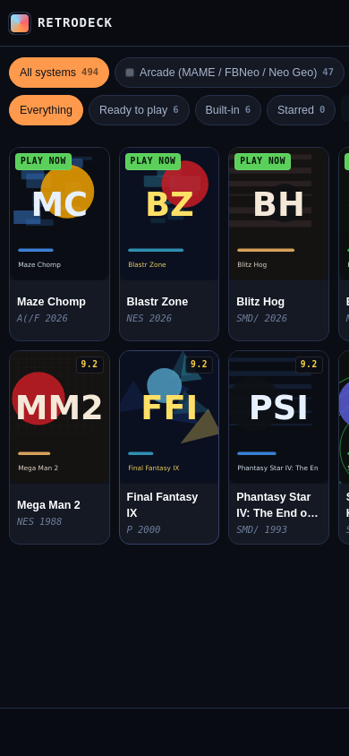

# RetroDeck


A pocket full of consoles, in a web page. 26 systems, 61 hardware models, 78
controller layouts, 50 skins, 488 classic titles indexed — and six original
games that are playable the moment you open the page, because they were written
for this repository and ship inside it.

It is a real emulator front-end, not a gallery: pick a Game Boy, and you get a
DMG-01 with its 2.6:2.4 screen box, four shades of green unless you say
otherwise, a diagonal A/B pad, a `4× AA` battery line on the shell and a
start/select pair you can reach with your thumbs on a phone. Pick the Mega
Drive and the buttons, the aspect ratio, the core and the 6-button layout all
change with it. Every one of those choices is a per-model and per-game setting,
stored on your device.

- **No build step, no dependencies.** Plain ES modules, one tiny static server,
  zero npm packages at runtime. `node_modules` never appears in this repo.
- **No bundler, no framework, no CDN for the UI.** The only network dependency
  is the emulator runtime, which you can mirror into `vendor/` in one command.
- **Nothing you import leaves the device.** Files go into IndexedDB on your own
  origin; settings into `localStorage`. There is no backend, no account, no
  analytics, no telemetry.

## Run it

```sh
npm run build      # index the catalogue + anything in homebrew/ (no deps needed)
npm start          # http://0.0.0.0:4173  (npm run dev is the same thing)
```

Then open `http://localhost:4173`. For the threads-capable cores
(Nintendo 64, PPSSPP, some Saturn and PSX builds) the browser wants
`SharedArrayBuffer`, which needs cross-origin isolation:

```sh
npm run vendor:serve      # server.mjs --threads -> COOP/COEP headers
```

## Play it right now

Six games live in `js/games/`, written from scratch for this project: original
code, original art, original audio, no ROM required, no emulator core either —
they run on a 300-line canvas engine with a fixed 60 Hz step, and they use the
same virtual pad, the same skins and the same configuration layer as cartridge
games.

| Game | Deck it wears | What it is |
| --- | --- | --- |
| **Maze Chomp** | arcade 4-way | a maze chase with a generator, not a maze copied from anywhere |
| **Blastr Zone** | NES | grid bombing, 8-way, four enemies with different appetites |
| **Blitz Hog** | Mega Drive 3 | a momentum platformer with a boar that cannot stop quickly |
| **Brick Storm** | NES | wall breakers, patterns per level, one power-up that matters |
| **Stack Drop** | Game Boy | ten columns, seven shapes, no mercy |
| **Star Lancer** | arcade 4-way | vertical shooter, wave patterns, a boss every fifth wave |

Everything else in the library is an *index* of classic titles — the metadata,
the year, the player count, the quirks ("battery save", "needs multi-tap",
"6-button pads"). Each card's cover is drawn in the browser (a deterministic
mosaic, flat poster or cartridge label per title - `Settings ▸ Look ▸ Card
artwork`), because this repository ships no box art and links to no image host.
Want real images instead? Two ways, both documented in [`covers/README.md`](covers/README.md):
**Add artwork** on a game's sheet keeps your own file in the vault (resized to
560 px, offline forever), or drop `covers/<system>/<title-slug>.png` on the
server and `npm run build` - the sheet prints the exact path it is looking for. To play those you supply your own copy of a file you are
allowed to hold, and RetroDeck runs it. This project ships no game files,
hosts none, and links to none; see [`NOTICE.md`](NOTICE.md).

If you have freely licensed homebrew of your own, drop it in
`homebrew/<system>/` and run `npm run build` — it becomes a real catalogue
entry that plays with no import step and works offline. [docs/ADDING-GAMES.md](docs/ADDING-GAMES.md).

## On a phone

`manifest.webmanifest` + a service worker make it installable, and
*Settings ▸ Install & updates* is the honest version of that: a real *Install
RetroDeck* button appears only when the browser has handed the page an install
prompt, the manual routes (Chrome ⋮ → *Install app*, Safari Share → *Add to Home
Screen*) are shown when it has not, and *Reload now* appears only while a new
build is genuinely waiting. After the first load the interface works with the radio off —
only the emulator payload needs to have been cached or vendored (see below).
The player is built for thumbs first: the pad floats over the picture, the
screen keeps its hardware aspect ratio, double-tap opens the core's own menu,
and holding the phone sideways swaps the pad to left/right edges.

## What "model console" actually means here

```
js/data/systems.js   26 systems: cores, extensions, aspect, palettes, shaders,
                     BIOS requirements, the button set, hardware features
js/data/models.js    61 revisions: DMG-01 vs Pocket vs Light, AGB-001 vs SP
                     (front-lit, ir), NES-001 vs Top Loader vs Compoboy,
                     every PS One/SCPH revision, Nomad, Gambler, the Duo…
js/data/layouts.js   78 controller layouts in one 100×46 unit field, each with
                     its own widget geometry (dpad style, nub travel, 6-button
                     rows, trackballs, light guns, keybeds, VMU screens)
js/data/skins.js     50 skins (22 CSS variables each) + 10 aftermarket ones,
                     plus the accent a model wants
data/source/         the inputs: games.tsv (488 rows) and emulatorjs.json, a
                     snapshot of what the runtime publishes today
js/core/shell.js     17 SVG shell templates; every model draws its own hardware
                     and the screen box that the game is placed inside
```

`systems.js` also names the emulator core each deck boots, and those are the
runtime's names, not the console's: the NES deck boots `fceumm`, Game Boy boots
`gambatte`, Mega Drive boots `genesis_plus_gx`. Getting that wrong is invisible
until the first game - `cores/nes-wasm.data` is a 404 - so it is not left to
anyone's memory. `data/source/emulatorjs.json` records what the CDN publishes
today (48 cores, with the extensions each one reads, plus the version
directories that exist), and `npm test` fails if a deck's `ejsCore` or any core it
offers is not in that list, if a deck claims a format none of its cores can read,
or if the channel dropdown offers a version that is not a real directory.
`node tools/refresh-runtime.mjs` refreshes the snapshot when upstream renames
something; the fix then belongs in the deck, in the same commit.

Two things you can see in the app because of it: the Dreamcast deck will not boot a
disc, because this runtime publishes no flycast core - it says so, in a sentence,
and offers Saturn instead - and the SNES deck offers one core, because that is all
there is.

A model is not a picture: `buildShell(model)` returns the geometry that decides
where the canvas goes, which pad is offered, which skin is default, and what
`EJS_*` options are passed to the core. The same table drives the library
cards, the deck screen, the config form and the player, which is why the DMG
always looks like a DMG.

## Configuration ladder

```
defaults  →  system  →  game            (store.resolvedFor)
```

Per system and per game you can set: model, core, controller layout, key map,
shader, palette, aspect ratio, integer scaling, screen rotation, save-state
slot behaviour, rewind, fast-forward, volume, rumble, haptics, pad size and
opacity, BIOS file, whether the emulator's own menu is reachable, and the
`EJS_*` source (CDN or `vendor/`). Settings are text, so they diff, sync and
commit: **Settings ▸ Your data ▸ Export** gives you one JSON file; **Import**
puts it back.

## Saving

Save states (F2 / the 💾 button, ten slots, each with a screenshot), battery
SRAM (captured on quit *and* on the core's own save event), screenshots to
your photo library, and a rewind buffer you can dial from 0 to 40 frames. All
of it is in the same IndexedDB vault as your files, and every record shows up
in **Cartridges ▸ Save states** where you can delete or export one.

## Going fully offline

```sh
npm run vendor                      # one blob per core: each deck's default (20)
npm run vendor -- --list            # what that means, before downloading it
npm run vendor -- --all             # all 48 cores this runtime publishes
npm run vendor -- --cores gambatte,mgba,snes9x
npm run vendor -- --full --threads  # every core any deck can be set to, + threaded builds
```

That mirrors the payload into `vendor/data/` with the layout the CDN uses -
`loader.js`, `emulator.min.js`, `emulator.min.css`, `cores/cores.json`, and one
`cores/<name>-wasm.data` per core - tens to a couple of hundred MB depending on
which cores you ask for; git-ignored, resumable, idempotent, and verified
against a local mirror by `npm test`. Then
choose *./vendor (self-hosted)* under **Settings ▸ Emulator ▸ Payload source** and the app needs
nothing but its own origin — the right setting for a phone, a classroom, a
museum kiosk or a plane.

## Tests

```sh
npm test            # 26 checks, ~7 s, no dependencies
npm run github:push -- <owner>   # publish with only a token (tools/publish.sh)
npm run test:fast   # the static ones only
npm run test:sw     # sw.js against stubs, nothing else can reach it
npm run imports     # every module in js/, imported under the DOM shim
npm run sim         # the six built-in games, frame by frame, with fake input
npm run serve:check # boots its own server, crawls the module graph, probes traversal
npm run audit       # classes and CSS variables the JS renders vs what css/ defines
```

Nineteen checks, because a project with no build step has no compiler to catch
drift - and no browser in this sandbox either, so every one of them runs in node:



**The browser.** `npm run test:browser` boots the real app in headless chromium and
asserts 26 things no node test can: that the isolation headers make
`SharedArrayBuffer` exist, that a built-in game paints (the canvas is sampled,
twice), that offline serves the shell from the service-worker cache, that
importing a file opens a real file chooser, detects its console and mounts a
core, that the install row in Settings matches what the browser actually offered,
and that "ask before leaving a running game" raises a *browser* dialog on reload -
not only the in-app sheet. It is opt-in because it needs a browser binary -
`npm test` stays installable with no network. CI runs it as its own job, and the
suite checks that the lane can always *finish*: a browser whose renderer died with
a core inside it can hang `close()` forever, which reads as a failed job under a
green list of assertions.

**The data.** `node --check` on all 47 modules (app, tools, server). Every model's `tpl`, `pad` and
`skins` reference resolves, and `buildShell` renders all 61 shells with a sane
screen box. Every pad id a system advertises exists in `layouts.js` (and 77 of
the 78 layouts are used), no widget escapes its field, button `ejs` indexes are
inside the core's table, every key entry is a real `KeyboardEvent.code`, every
`controlScheme` name is one EmulatorJS accepts, and no deck is left holding a
core named `auto` it cannot resolve. Skins supply all 22 CSS variables in
parseable colours. `js/data/games.generated.js` is byte-for-byte re-derivable
from `data/source/games.tsv` plus `homebrew/`, with unique ids and correct
per-system tallies.

**The app.** The six built-in games are simulated frame by frame in
`tools/sim.mjs` (300 frames on a cycling input profile, 900 sprinting: input,
scoring, level flow, game-over, storage writes). Every module imports under the
DOM shim, so a missing named export cannot survive a commit. Card artwork is
covered too: an image picked on a game's sheet is stored in the vault, read back
by the card and removable, a cover file the build indexed renders as a real
``, and one that has gone stale falls back to the generated cover.
`tools/dom-smoke.mjs` then boots the *whole* app headlessly: it imports
`js/app.js`, visits every route, mounts each built-in, imports a fake Game Boy
image into the vault, attaches it to a catalogue entry, opens the game sheet,
presses a pad button, saves a state through the real toolbar, captures a key
into the keyboard map and leaves the player - asserting that every view produced
markup instead of throwing.

**The runtime.** `tools/test-vendor.mjs` runs the EmulatorJS mirror against a
fake CDN on a loopback port and requires byte-identical files, a sane manifest,
tolerated optional 404s, an idempotent re-run and a hard failure for a dead
mirror. `tools/test-sw.mjs` executes `sw.js` against stubs and checks what it
intercepts: the game index and the app's modules get cached, a `blob:` ROM url
and any `Range` request are left alone, the tens-of-megabytes `cores/*-wasm.data`
blobs stay in the runtime's own IndexedDB, and a cold offline navigation still
opens the app.
`tools/serve-check.mjs` speaks real HTTP to a real server - every `src`/`href`
in `index.html`, all 28 modules reachable from `js/app.js`, COOP/COEP, ETag
revalidation, `HEAD`, byte ranges, module and WASM content types - and writes a
marker file one level *above* the repo to prove `/%2e%2e/` tricks cannot read
it. (The server once answered `/` with a 404 because its root was resolved one
directory too high, which also made everything in that parent readable; that is
the bug this check exists for.)

**The repo.** Nothing in any document links to a game file this project does not
have; every id `js/` looks up exists in `index.html`; every file the manifest and
the service worker name is on disk; `css-audit` fails on a class the JS renders
with no rule, or a `var()` with neither a definition nor a fallback; and the 26
`homebrew/` folders exist with their generated READMEs.

## Layout

```
index.html            one page, five tabs, the player overlay
manifest.webmanifest  installable PWA
sw.js                 cache + warm-the-runtime messages
css/                  tokens, pad, shell, app  (no preprocessor)
js/core/              store, idb vault, ROM sniffing, cover art, shell art,
                      virtual deck, EmulatorJS player
js/data/              systems, models, layouts, skins, generated catalogue
js/games/             the built-in engine + six original titles
js/views/             home, library, decks, deck, vault, settings, player
js/ui.js              100-line element builder, sheets, toasts, file pickers
server.mjs            static server: wasm/mjs types, ETag, ranges, COOP/COEP
tools/                build, test, sim, css audit, icons, vendor mirror, runtime
                      snapshot refresh, import check, sw/server checks, dist builder,
                      publish (tools/publish.sh, token from GH_TOKEN only)
docs/DEPLOYING.md     dist/, four hosts, the two headers that matter, offline mirror
docs/PLAYING.md       imports, controls, saves (and why they are one-way), slow, offline
CONTRIBUTING.md       where each kind of change goes, and the two rules the repo learned
CHANGELOG.md          what shipped, what was fixed, what a deployment has to do
covers/<system>/      drop box art here (or per game from the app) - see covers/README.md
homebrew/<system>/    drop freely-licensed files here, then npm run build
docs/img/             the screenshots above, taken by the browser check itself
```

## Browsers

Any browser with ES modules, IndexedDB and WebAssembly: Chrome/Edge 90+,
Safari 15+, Firefox 90+, and their mobile equivalents. `SharedArrayBuffer`
(needed by a few cores) requires the cross-origin-isolated context that
`npm run vendor:serve` sets up. Everything except the emulator payload works
without WebAssembly — which is how the built-in games, the vault, the decks and
the settings run in a test runner with no browser at all.

## Licence

MIT for everything in this repository (see [`LICENSE`](LICENSE)). The emulator
runtime and the cores it loads are upstream projects under their own licences;
game data is not included and is not something this project helps you obtain.
Read [`NOTICE.md`](NOTICE.md) — it is three paragraphs.
